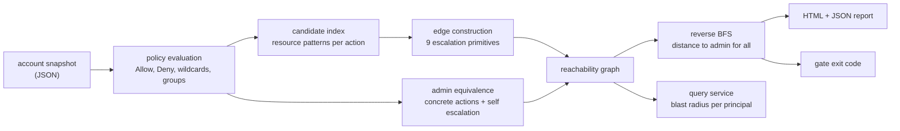

# iam-blast-radius

**Computes IAM privilege reachability from policies and trust. On the bundled account, <!--number:analysis.mislabelled_pct-->23.3<!--/number--> percent of principals labelled least privilege reach administrative access anyway.**

[](https://github.com/__GITHUB_USERNAME__/iam-blast-radius/actions/workflows/ci.yml)
[](https://github.com/__GITHUB_USERNAME__/iam-blast-radius/actions/workflows/coverage-badge.yml)
[](docs/metrics.json)
[](https://github.com/__GITHUB_USERNAME__/iam-blast-radius/pkgs/container/iam-blast-radius)
[](https://__GITHUB_USERNAME__.github.io/iam-blast-radius/)
[](LICENSE)

## What this solves

- **A severity label is not a blast radius.** This computes reachability: if a principal is compromised, what is obtainable, through which escalation primitive, in how many hops. On the bundled account <!--number:analysis.escalating-->302<!--/number--> of the non administrative principals reach admin, which is <!--number:analysis.escalating_pct-->15.6<!--/number--> percent.
- **Least privilege is an intention; reachability is a fact.** The tool reports against the label rather than trusting it. Here, <!--number:analysis.mislabelled-->221<!--/number--> of <!--number:analysis.labelled_least_privilege-->947<!--/number--> principals tagged least privilege reach admin anyway.
- **Paths, not scores.** Every finding carries the principals it passes through and the technique at each step, because a number tells somebody there is a problem and only a path tells them which statement to delete.

## The problem

IAM findings get triaged by severity. A policy with `iam:PassRole` scores
medium, gets a ticket, and sits in a backlog behind the criticals.

The question that decides whether a compromise is contained is not how a scanner
scored the policy. It is whether a principal can reach administrative access,
and how far it has to go. Those are different questions and the second one is
transitive, which is why nobody answers it by reading policies: the path runs
through three principals and no single policy document contains it.

This builds the graph. Nodes are principals; an edge from A to B means a
compromise of A yields B's privileges through one of
<!--number:analysis.escalation_edge_kinds-->9<!--/number--> documented escalation
primitives. Then it answers both questions that matter: across the account, who
reaches admin and at what distance; and for one principal, what does a
compromise touch.

On a synthetic account of <!--number:analysis.principals-->2,177<!--/number-->
principals and <!--number:analysis.edges-->112,493<!--/number--> edges,
<!--number:analysis.at_one_hop-->209<!--/number--> principals reach administrative
access in a single step and <!--number:analysis.at_two_hops-->93<!--/number--> in
two. That account is generated, so those figures are a simulation, and the
generator ships in the repository.

## What makes an edge

The tool is exactly as correct as `src/ibr/graph/edges.py`. A missing edge is a
principal reported contained when it is not, which is worse than not running the
tool at all because it manufactures confidence. The full list with rationale is
in [docs/edges.md](docs/edges.md); three preconditions are worth stating here
because each of them was a bug before it was a check.

**`sts:AssumeRole` means nothing without the trust policy.** Holding the action
is half the requirement; the target role has to name the principal. Skipping
this turns every principal with `sts:AssumeRole` into a path to every role in
the account.

**Passing a role to a service requires the service to trust it.** A role that
does not trust `lambda.amazonaws.com` cannot back a function, so `iam:PassRole`
plus `lambda:CreateFunction` against it is not a path. The first version created
those edges and every one of them was false.

**Resource scope is evaluated.** A principal allowed `iam:CreateAccessKey` only
on its own ARN reaches nobody. The bundled account contains
<!--number:analysis.self_scoped_principals-->232<!--/number--> of these
deliberately, because the resource scoping needs something to get right and a
policy grep gets every one of them wrong.

## Architecture



No AWS calls anywhere in that diagram. The account is a file, the analysis path
has no network code in it, and the service holds no credentials. That is
[ADR-001](docs/adr/adr-001-graph-over-policy-simulator.md), and the reason is
that a service which could refresh itself from AWS would need a role with
`iam:List*` across the account, which is a more attractive target than the
report it produces.

## Tech stack

| Technology | Role in this project | Why chosen here |
| --- | --- | --- |
| Python 3.11+ | Core, CLI, service | The language the cloud security tooling around it is written in |
| networkx | The reachability graph | A graph of this size belongs in process; a graph database would be a service to operate and back up for a weekly audit |
| FastAPI | Query service | Reachability questions are interactive during an incident, and the schema models double as the response contract |
| pydantic | Response models | Comes with FastAPI and makes the API's shape a declaration rather than a convention |
| uvicorn | ASGI server | What FastAPI documents; nothing here needs more |
| Typer | CLI with four verbs | Typed arguments and subcommands with a small dependency surface |
| Jinja2 | HTML report | The report is what gets attached to a remediation ticket |
| Docker, multi stage | Distribution | The image is the unit people deploy. Runs as uid 10001 with no shell |
| pytest, pytest-cov | <!--number:quality.test_count-->173<!--/number--> tests, <!--number:quality.test_coverage_pct-->98.2<!--/number--> percent branch coverage | Runs with no AWS account, no credentials and no network |

## Quickstart

Prerequisites: Python 3.11 or newer, and git. No AWS account, no credentials.

```bash
git clone https://github.com/__GITHUB_USERNAME__/iam-blast-radius.git
cd iam-blast-radius
python -m venv .venv && source .venv/bin/activate
make install
make verify
```

Then analyse a generated account:

```bash
ibr generate --principals 2000 --out data/generated/account.json --seed 7
ibr analyse --account data/generated/account.json \
  --out docs/report.html --json docs/reachability.json
```

Or run the query service:

```bash
ibr serve --account data/generated/account.json
curl -s localhost:8000/summary
curl -s localhost:8000/principals/user/app-0013/blast-radius
```

As a container:

```bash
docker run --rm --read-only \
  -v "$PWD/account.json:/data/account.json:ro" \
  ghcr.io/__GITHUB_USERNAME__/iam-blast-radius:latest \
  analyse --account /data/account.json
```

To use a real account, export it and transform it to the snapshot format:
[docs/real-accounts.md](docs/real-accounts.md) covers the one API call it needs
and what to strip before the file leaves the machine.

To gate CI on an infrastructure-as-code repository:

```bash
ibr gate --account account.json --max-one-hop 0 --max-mislabelled-pct 0
```

Exit code 2 means a threshold was breached. Start from what the analysis reports
today and ratchet it down, because a gate nobody can meet gets disabled.

## Performance under load

Graph construction dominates and reachability is effectively free, which is the
shape the design produces on purpose: a single reverse breadth first search
labels every principal with its distance to admin, so the query cost does not
scale with the number of principals asking. Measured with
`benchmark/run_benchmark.py`, median of
<!--number:performance.repeats-->3<!--/number--> runs, on 2 vCPU with 8GB RAM,
Python 3.13 on Linux. Raw output is in `benchmark/results/benchmark.json`.

| Principals | Edges | Graph build | Reachability | Mislabelled |
| --- | --- | --- | --- | --- |
| <!--number:performance.scenarios[0].principals-->218<!--/number--> | <!--number:performance.scenarios[0].edges-->1,442<!--/number--> | <!--number:performance.scenarios[0].build_median_s-->0.074<!--/number--> s | <!--number:performance.scenarios[0].analyse_median_s-->0.001<!--/number--> s | <!--number:performance.scenarios[0].mislabelled_pct-->22.45<!--/number--> % |
| <!--number:performance.scenarios[1].principals-->2,177<!--/number--> | <!--number:performance.scenarios[1].edges-->112,493<!--/number--> | <!--number:performance.scenarios[1].build_median_s-->7.15<!--/number--> s | <!--number:performance.scenarios[1].analyse_median_s-->0.017<!--/number--> s | <!--number:performance.scenarios[1].mislabelled_pct-->23.34<!--/number--> % |
| <!--number:performance.scenarios[2].principals-->21,817<!--/number--> | <!--number:performance.scenarios[2].edges-->9,084,811<!--/number--> | <!--number:performance.scenarios[2].build_median_s-->713<!--/number--> s | <!--number:performance.scenarios[2].analyse_median_s-->0.829<!--/number--> s | <!--number:performance.scenarios[2].mislabelled_pct-->22.34<!--/number--> % |

The mislabelled percentage barely moves across the range, which is what makes it
a usable headline: it describes the account's hygiene rather than its size.

Reachability is effectively free at every size, because it is one traversal
rather than a search per principal. Graph construction is the cost, and it grows
with edges rather than with principals:

| Principals | Edges | Edges per principal | Build |
| --- | --- | --- | --- |
| 218 | 1,442 | 7 | 0.0743 s |
| 2,177 | 112,493 | 52 | 7.15 s |
| 21,817 | 9,084,811 | 416 | 713 s |

Edge count grows faster than principal count, and that is a property of the
account rather than an artefact of the tool. A principal allowed
`iam:CreateAccessKey` with no resource scope genuinely can create credentials
for every user in the account, so doubling the account doubles that principal's
out degree as well as the number of such principals. The graph is large because
the blast radius is large.

Memory is not the constraint: measured at roughly 190 bytes per edge, the
9,084,811 edge graph fits in about two gigabytes. Wall clock is. That
largest account takes 12 minutes to build and
then answers reachability for every principal in
0.83 seconds, which is the right trade for a weekly
audit and the wrong one for an incident.

The mitigation is already in the output rather than in a roadmap item. The one
hop count is the number worth acting on first, every one of those paths is a
single statement somebody wrote, and it is available from a partial graph. For
an account in a state where the full build is slow, that is also the state where
the one hop list is long enough to keep a team busy.

## Architecture decision records

Three decisions in [`docs/adr/`](docs/adr/), each with the options rejected and why:

- [ADR-001](docs/adr/adr-001-graph-over-policy-simulator.md): an offline graph rather than `iam:SimulatePrincipalPolicy`, and why the credential boundary matters more than the accuracy.
- [ADR-002](docs/adr/adr-002-one-traversal-not-a-search-per-principal.md): one traversal rather than a search per principal, with the 118 seconds and 35 seconds that forced it.
- [ADR-003](docs/adr/adr-003-over-report-rather-than-under-report.md): the boring choice. Every approximation errs toward reporting more reachability, and the one place it deliberately does not.

## Intentionally out of scope

**Condition key evaluation.** Keys are recorded, not evaluated. An edge that
depends on one is included and flagged, and
<!--number:analysis.conditional_only-->0<!--/number--> principals on the bundled
account reach admin only through such an edge. `--strict-conditions` drops them
for anybody who wants the set they can defend as certain.

**Permission boundaries and service control policies.** Recorded and not
applied, out of scope respectively. Both can only make the real answer more
restrictive than the reported one, which is the direction ADR-003 argues for.

**Multi account.** Cross account escalation runs through trust policies naming
external principals, which the model records and cannot resolve without the
other account's snapshot. A role trusting an external principal is reported as a
boundary and not followed. In an organisation this understates reachability, and
the README says so rather than letting a reader assume otherwise.

**Azure and GCP.** AWS only. The account model is the abstraction a second
provider would sit behind, and the honest reason it is not built is that three
shallow cloud integrations defend worse in a review than one deep one.

**Writing anything.** No remediation, no policy changes, no AWS calls at all.
The tool produces a path and a human decides.

## Security and compliance

An account's IAM configuration is a map of where to attack the organisation,
and so is this tool's output. That single fact shapes everything: the tool holds
no credentials, makes no AWS calls, and the report carries principal
identifiers, edge kinds and hop counts rather than policy documents.

The published image runs as uid 10001, a system user with no home directory and
no shell, built multi stage so it carries no compiler and no source tree. Full
threat model, including how to handle the snapshot and the report, in
[SECURITY.md](SECURITY.md).

## Failure modes

| Failure | Detection | Behaviour | Recovery |
| --- | --- | --- | --- |
| Account file missing | Checked before load | `FileNotFoundError` naming the path | Fix the path |
| Account file not JSON | Parsed with a specific handler | `AccountFormatError` naming the file | Re-export |
| Unsupported schema version | Version checked on load | Refused, naming the version this build reads | A silently misread account is a confidently wrong report |
| Invalid principal type or statement | Validated per entry | Refused, naming the offending principal | Fix the transform |
| Policy with no versions | Validated on load | Refused | An export missing versions cannot detect rollback escalation |
| Group membership cycle | Guarded in the traversal | Resolved without recursion | Bad input must not hang an audit tool |
| Edge rests on a condition | Flagged on the edge | Included and marked conditional | `--strict-conditions` to exclude |
| Principal unknown to the API | Checked before query | 404 naming the principal | Check the identifier |
| Service started with no account | Checked per request | 503, health endpoint reports it | Pass `--account` |
| Account larger than memory | Not handled | Out of memory | Out of scope: an account with millions of edges needs the one hop count, which is cheap |
| Published number drifts | `tools/check_numbers.py` in CI | Build fails | `make report`, update the document |

## Hardest problem solved

Three bugs, and they are the same bug: each one modelled half of a relationship
and called it done.

**The first was the easiest to see.** `iam:PassRole` plus `lambda:CreateFunction`
created an edge to every role in the account. The check modelled the caller's
permission to pass the role and not the role's willingness to be assumed by the
service. A role that does not trust `lambda.amazonaws.com` cannot back a
function, so the escalation fails at the first API call, and every one of those
edges was false.

**The second was more interesting because it looked right.** A principal holding
`iam:SetDefaultPolicyVersion` gained an edge to every principal whose attached
policy had any older version. Two errors stacked: rolling a policy back grants
the principal more of its own privileges, so there is no second principal and an
edge is the wrong shape for it entirely; and the version comparison asked whether
a non default version mentioned any action the default did not, so a rollback
from `s3:Get*` to `s3:List*` read as a path to administrative access. The fix was
to move it out of the edge list and evaluate it as self escalation, and only
when a non default version grants an action that is actually administrative.

**The third was a category error that survived because it was almost right.**
The admin equivalent action set contained the literal strings `*` and `iam:*`.
Asking whether a principal is allowed the action `*` matches an Allow on `*`,
while an explicit Deny on `iam:*` does not match it, because `*` is not an
action anybody can call. PowerUserAccess is exactly Allow `*` plus Deny `iam:*`,
and it was reported as administrative. Every entry is now a concrete API action,
which makes the Deny apply.

What ties them together is worth more than any of them. In each case I had
written the check from the attacker's side, asking what the source principal is
permitted to do, and stopped there. Every one of these primitives is a
relationship with two ends: a caller's permission and a target's consent, whether
that consent is a trust policy, a service principal, or the simple fact that
there is no target at all. The test convention that came out of it is that every
edge needs two tests, one asserting it appears and one asserting it does not when
a precondition is missing, and the second half is what catches an edge that
reaches everybody.

Fixes: [`43f17fc`](../../commit/43f17fc), [`c2666f8`](../../commit/c2666f8), [`95c3dca`](../../commit/95c3dca).

## Future work

- **Multi account.** The largest gap, and the honest reason it is not done is that joining snapshots exported weeks apart produces paths that no longer exist. Issue 01 has the design.
- **Optional verification against the policy simulator.** The only way to measure this tool's false positive rate against the authority rather than against its own fixtures. Issue 03.
- **Remediation ordering.** Which single statement removal closes the most paths, which is the first question a remediation owner asks and the report does not answer. Issue 05.
- **Before production use:** confirm the export carries every managed policy version, not just the default. An export missing versions cannot detect rollback escalation and will report an account as cleaner than it is.
- **First metric to watch after deploying:** the one hop count, not the total. Two hop paths come and go as unrelated policies change; a one hop path is a single statement somebody wrote, and the count going up means a review was skipped.

## License

MIT. See [LICENSE](LICENSE).
